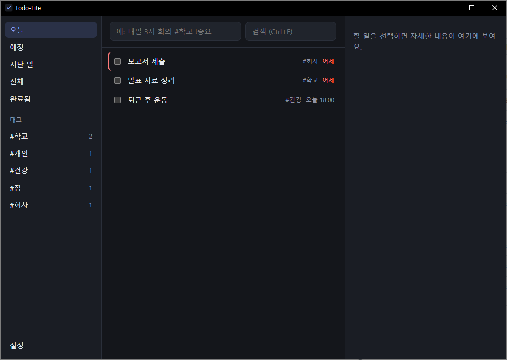
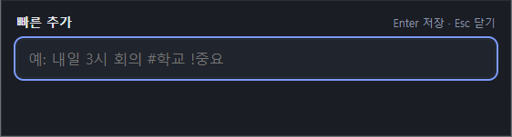

# Todo-Lite

자연어 한 줄로 할 일을 적으면 마감일·우선순위·태그가 알아서 정리되는, 가볍고 오프라인 우선인 개인용 투두 앱입니다. Rust 코어와 Tauri 2 + Svelte 5 화면으로 만든 Windows 데스크톱 앱입니다.



```
내일 오후 3시 팀플 회의 #학교 !중요
→ 제목 "팀플 회의" · 마감 내일 15:00 · 태그 #학교 · 우선순위 높음
```

## 주요 기능

- **자연어 빠른 입력**: 입력하는 동안 마감·태그·우선순위를 칩으로 미리 보여 주고, Enter로 저장합니다. 한글 입력기(IME) 조합 중의 Enter는 저장하지 않습니다.
- **보기와 정리**: 오늘 / 예정 / 지난 일 / 전체 / 완료됨, 태그별 필터, 제목·메모·태그 검색, 마감일·시각·우선순위 순 정렬.
- **상세 편집**: 제목, 마감일, 시각, 우선순위, 태그, 메모. 완료하면 5초 동안 "되돌리기"를 할 수 있고, 삭제는 확인을 거칩니다.
- **트레이 상주**: 창의 X를 눌러도 꺼지지 않고 시스템 트레이에서 계속 실행됩니다. 트레이 메뉴는 열기 / 빠른 추가 / 종료이고, 앱을 두 번 실행하면 기존 창이 앞으로 옵니다.
- **전역 단축키 빠른 입력창**: 다른 프로그램을 쓰는 중에도 `Ctrl+Alt+Space`를 누르면 화면 아래쪽 가운데에 작은 입력창이 뜹니다. 단축키는 설정에서 바꿀 수 있습니다.

  

- **Windows 시작 시 자동 실행**(설정, 기본 꺼짐): 켜면 로그인할 때 창 없이 트레이로 시작합니다.
- **클라우드 폴더 동기화**: Google Drive나 OneDrive처럼 자동으로 동기화되는 폴더를 고르면, 같은 폴더를 가리키는 다른 기기와 할 일이 맞춰집니다. 서버나 계정은 필요 없고, 폴더를 고르지 않으면 이 기기에만 저장됩니다.
- **오프라인·로컬 저장**: 데이터는 SQLite 파일 하나에 저장되고, 네트워크 호출이 없습니다.

## 자연어 입력 예시

| 입력 | 해석 |
|---|---|
| `내일 오후 3시 팀플 회의 #학교 !중요` | 내일 15:00, #학교, 높음 |
| `모레 오전 10시 치과 !!` | 모레 10:00, 높음 |
| `다음 주 금요일 14:30 발표 리허설 #학교 #팀플` | 다음 주 금요일 14:30, 태그 2개 |
| `10월 30일 과제 제출`, `10/30 팀플`, `2026-11-15 졸업 사진` | 절대 날짜 |
| `3일 후 반납`, `이번 주 일요일 청소` | 상대 날짜 |
| `점심 약속`, `저녁 7시 영화` | 12:00, 19:00 |
| `회의록 정리 내일까지` | 내일 (조사 "까지"는 제목에서 빠짐) |
| `책 읽기 !낮음` | 우선순위 낮음 |

- 우선순위: `!중요` `!높음` `!!` → 높음, `!낮음` → 낮음
- 날짜 없이 시각만 쓰면 오늘입니다. 접두어 없는 `3시`는 03:00이고, 오후는 `오후 3시`라고 씁니다.
- 연도 없이 쓴 날짜가 이미 지났으면 내년으로 해석합니다. `2월 29일`은 다음 윤년으로 갑니다.
- 알려진 한계: `우유 1/2 통`의 `1/2`는 1월 2일로 읽힙니다. 붙여 쓴 `오후 3시회의`는 시각으로 인식하지 않습니다.

## 키보드

| 키 | 동작 |
|---|---|
| `Ctrl+Alt+Space` | (어디서나) 빠른 입력창 |
| `Ctrl+N` | 입력창으로 이동 |
| `Ctrl+F` | 검색 |
| `↑` `↓` | 할 일 선택 이동 |
| `Space` | 완료 / 완료 취소 |
| `Enter` | 제목 편집 |
| `Del` | 삭제 (확인 후) |
| `Esc` | 포커스 해제 / 창 닫기 |

## 설치와 실행

### 빌드에 필요한 것

- Windows 10/11, [WebView2 런타임](https://developer.microsoft.com/microsoft-edge/webview2/) (Windows 11에는 기본 포함)
- [Rust](https://rustup.rs/) 1.90 이상 (MSVC 툴체인)
- [Node.js](https://nodejs.org/) 22 이상

### 개발 모드로 실행

```powershell
npm install
npm --prefix ui install
npm run dev
```

`npm run dev`는 브라우저가 아니라 데스크톱 창을 띄웁니다. 개발 서버 주소(`localhost:1420`)를 브라우저에서 열면 화면만 보이고 저장은 동작하지 않습니다.

### 설치 파일 만들기

```powershell
npm run build
```

결과물은 `target\release\bundle\nsis\Todo-Lite_0.1.0_x64-setup.exe`입니다(약 3MB, WebView2가 없는 PC에서는 설치 중에 내려받습니다).

### 샘플 데이터로 둘러보기

```powershell
cargo run -p todo-core --example seed_demo -- "$env:TEMP\todo-lite-demo\todo.db"
$env:TODO_LITE_DATA_DIR = "$env:TEMP\todo-lite-demo"
npm run dev
```

`TODO_LITE_DATA_DIR`을 지정하면 실제 데이터(`%APPDATA%\com.todolite.desktop\todo.db`)와 섞이지 않습니다.

## 테스트

```powershell
cargo test --workspace            # Rust: 코어 74개 + 앱 25개
cargo test --workspace --release  # 1만 건 목록·검색 성능 테스트 포함
npm --prefix ui run test          # 화면 로직(Vitest) 46개
npm --prefix ui run check         # svelte-check
```

`scripts\smoke-tray.ps1`은 릴리스 실행 파일을 격리된 데이터로 띄워 트레이 상주와 빠른 입력창(교착 없음, 위치)을 자동으로 확인합니다. 화면에 키나 마우스 입력은 보내지 않습니다.

## 구조

```
crates/todo-core/   UI와 무관한 Rust 코어: 모델, SQLite 저장소, 조회, 한국어 자연어 파서, 폴더 동기화
src-tauri/          Tauri 앱: 코어를 감싸는 Api, 커맨드, 트레이, 빠른 입력창, 전역 단축키
ui/                 Svelte 5 화면 (메인 창과 ?view=quick 빠른 입력창)
scripts/            측정·스모크·스크린샷 PowerShell 스크립트
docs/PRD.md         요구사항, 측정 결과, 검증 상태
```

코어를 UI와 분리해 두어서, 이후 Android(Tauri 모바일)나 LLM 기반 파서를 코어 수정 없이 붙일 수 있게 했습니다.

## 동기화 방식

기기마다 자기 변경 기록 파일(`<기기ID>.jsonl`)에만 덧붙여 쓰고, 다른 기기의 파일을 읽어 합칩니다. 같은 할 일이 양쪽에서 바뀌면 마지막 수정이 이깁니다. 기기 시계가 어긋나도 수정이 항상 이전 버전보다 새롭게 기록되므로 두 기기의 결과가 같아집니다. 업로드 중 끊긴 줄이나 깨진 줄은 건너뜁니다.

## 측정 (Windows, 릴리스 빌드, 한 대의 PC)

| 항목 | 목표 | 결과 |
|---|---|---|
| 설치 파일 | < 50MB | 약 3MB |
| 유휴 메모리 (WebView2 포함, 프라이빗 작업 집합) | 약 100MB 이하 | 메인만 78~82MB, 빠른 창을 띄운 뒤 99~105MB |
| 시작 시간 | 빈 Tauri 앱 대비 +0.5초 이내 | +0.32~0.35초 (절대값 약 2.0초) |
| 1만 건 목록·검색 | < 100ms | 약 44ms |
| 빠른 입력창 첫 표시 | — | 약 0.45초, 이후 재사용 |

자세한 측정 방법과 조건은 [docs/PRD.md](docs/PRD.md)에 있습니다.

## 로드맵

- **v2**: 마감 알림, 반복 일정, 하위 할 일, JSON 내보내기/가져오기
- **v3**: Android 빌드 (동기화 폴더는 Syncthing·FolderSync 등으로 맞춤)
- **선택**: LLM 기반 자연어 파서

## 라이선스

아직 정하지 않았습니다.
